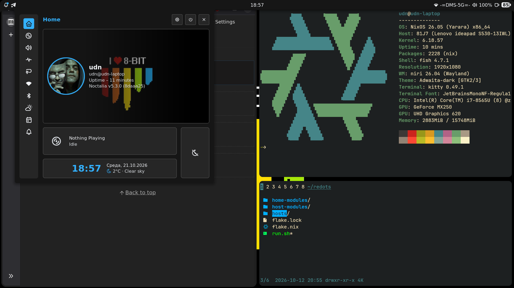

# redots

My own NixOS configuration that shares to all my Linux devices.

This flake exposes only one module `redots.nixosModules.default` that includes
all configuration under feature gates. For example, for my private configuration
I just import current flake and import main module for all target systems.

## Desktop features

On the desktop side:
- [Niri](https://github.com/niri-wm/niri) scrolling compositor
- [Noctalia](https://github.com/noctalia-dev/noctalia) shell
- [Kitty](https://github.com/kovidgoyal/kitty) terminal emulator

And for the terminal:
- [Fish](https://github.com/fish-shell/fish-shell) shell
- [nnn](https://github.com/jarun/nnn) file manager
- [direnv](https://github.com/direnv/direnv) with
  [nix-direnv](https://github.com/nix-community/nix-direnv) environment management
- [btop](https://github.com/aristocratos/btop) resource monitor
- [Helix](https://github.com/helix-editor/helix) editor
- [Lazygit](https://github.com/jesseduffield/lazygit) repository viewer
- And a lot of everyday utilities

## To be done

- Secrets management
- Public VPS configuration with one-command deploy
